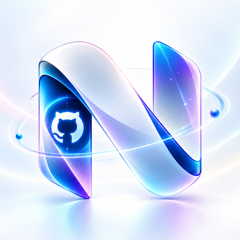
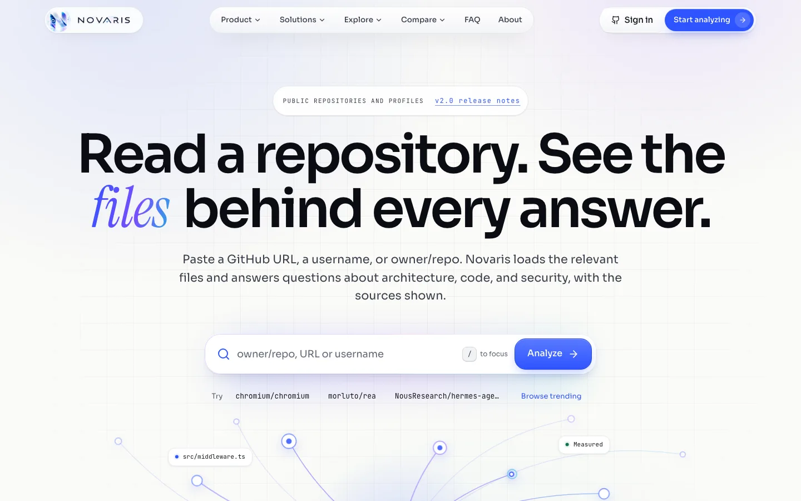
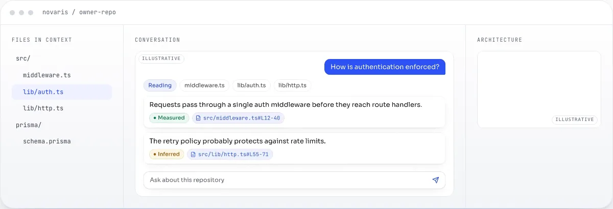
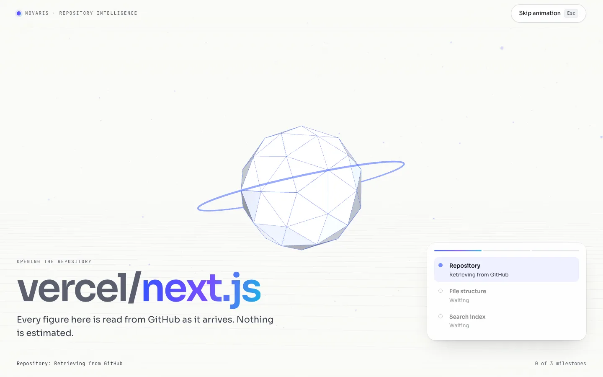
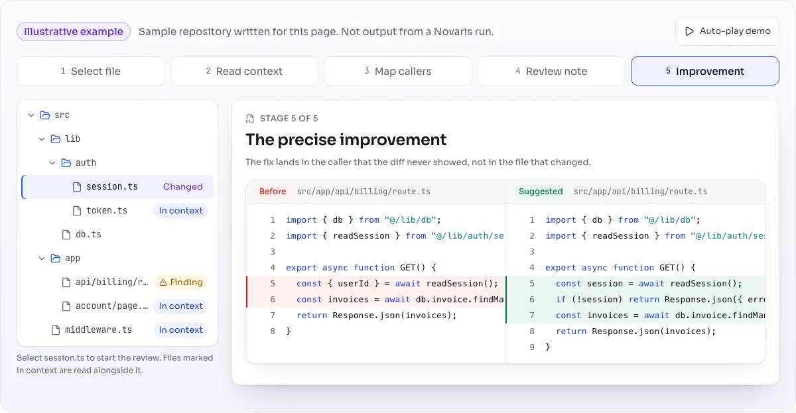
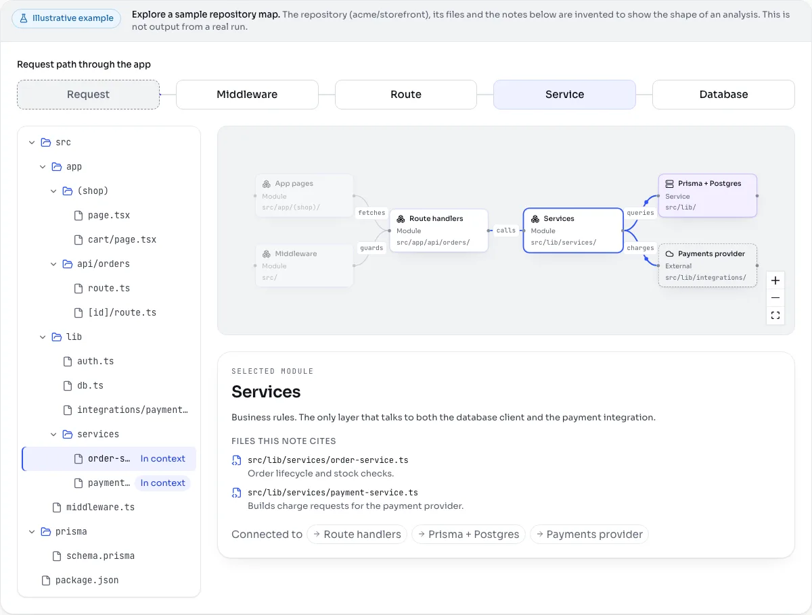
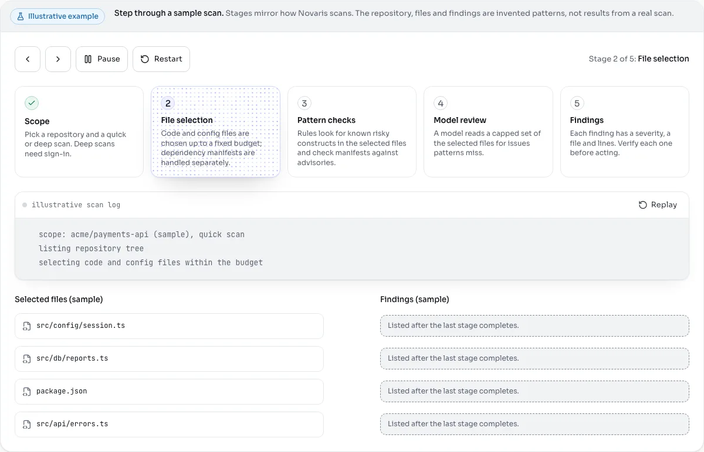
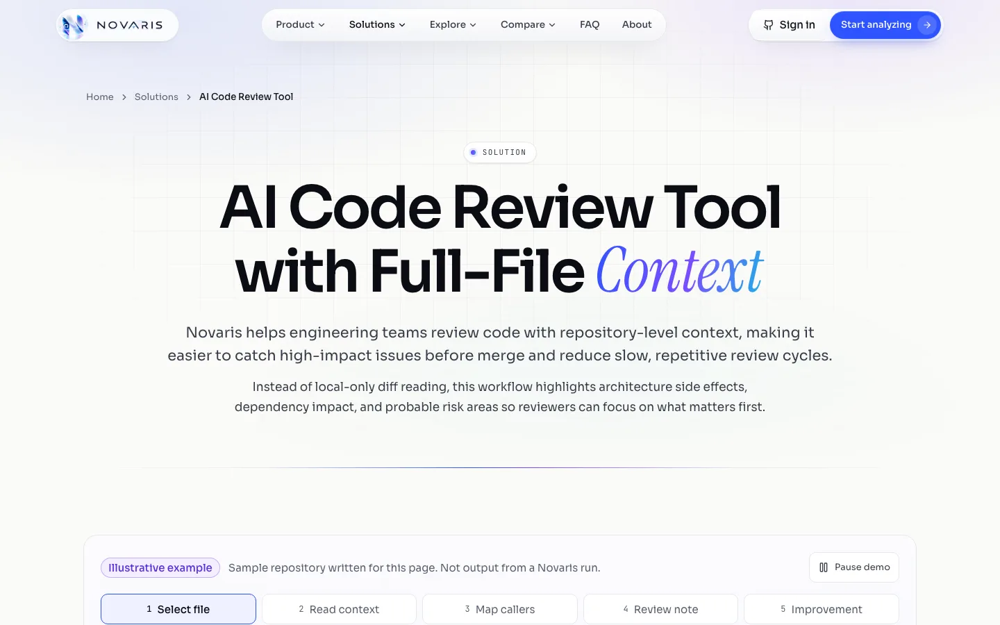
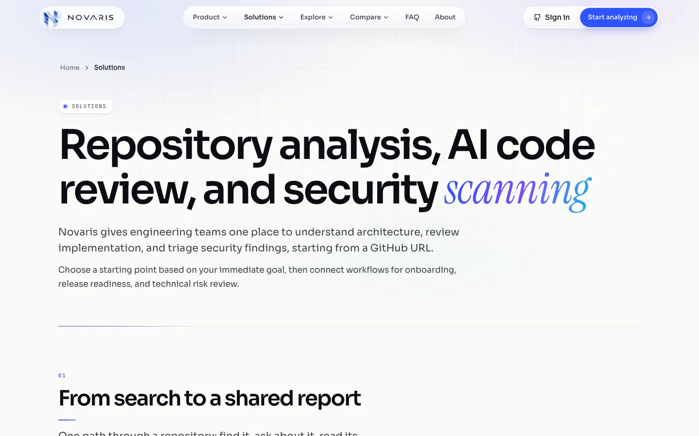
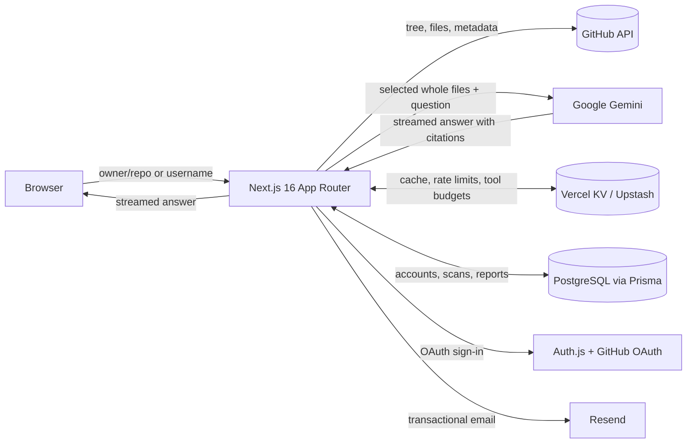

<div align="center">




### Read a repository. See the files behind every answer.

Novaris answers questions about GitHub repositories and developer profiles, reviews code with the whole file in view, and runs security scans that cite a file and a line for every finding.

[](https://novaris.in)
[](https://nextjs.org)
[](https://react.dev)
[](tsconfig.json)
[](https://ai.google.dev)
[](LICENSE)

[Live site](https://novaris.in) · [Features](#features) · [Architecture](#architecture) · [Local setup](#local-setup) · [Environment](docs/ENVIRONMENT.md) · [Security](#security)

<br />



</div>

---

## How it works

You give Novaris a username or an `owner/repo`. It reads public data from the GitHub API, picks the files that matter for your question, sends those whole files and the metadata to Google Gemini, and streams back an answer. Each claim either cites a file and line range or is labelled as inferred. Anything the data does not show is reported as unknown.

<table>
  <tr>
    <td width="50%" valign="top">
      
      <p><b>Ask. Read. Verify.</b><br />Files in context, a conversation with cited claims, and an architecture map side by side. Shown with sample values.</p>
    </td>
    <td width="50%" valign="top">
      
      <p><b>Opening a repository</b><br />Every figure is read from GitHub as it arrives. Progress follows real stages: repository, file structure, search index.</p>
    </td>
  </tr>
</table>

## Features

| Feature | Where | What it does |
| --- | --- | --- |
| Repository chat | `/chat?q=<owner>/<repo>` | Picks relevant files from the tree (Gemini plus a local keyword index), reads them whole, and streams a cited answer. Mermaid diagrams render inline. |
| Profile chat | `/chat?q=<username>` | Profile, READMEs, recent commits, PRs, issues and releases are fetched as tools during the answer. |
| File browsing and code search | Chat sidebar | Keyboard-navigable file tree for repositories with tens of thousands of files, file preview, text search across indexed files. |
| Security scans | Chat, `/report/<scan_id>` | Quick scans for anyone; deep scans need sign-in and are capped per month. Findings carry severity, file and lines, and go through a verification pass. Reports can be filtered by severity and grouped by file. |
| Report sharing | `/report/shared/<token>` | Owner-issued, read-only links that expire with the report. Viewers can flag false positives. |
| Dashboard | `/dashboard`, `/dashboard/repos`, `/dashboard/starred`, `/dashboard/scans` | Requires GitHub sign-in. Private repositories appear only if you grant the `repo` scope. |
| Trending and explore | `/trending`, `/explore`, `/topics/<topic>` | Backed by a weekly catalog snapshot in `public/data/top-repos.json`. |
| Guides | `/solutions`, `/ai-code-review-tool`, `/security-scanner`, `/compare` | Interactive, clearly labelled illustrative demonstrations of each workflow. |
| Blog and admin | `/blog`, `/admin` | Admin is limited to the GitHub user named in `ADMIN_GITHUB_USERNAME`. |

Not implemented: a public REST API, side-by-side repository comparison (`/compare` is a set of guide articles), and user settings (`/dashboard/settings` shows a "coming soon" notice).

## Gallery

<table>
  <tr>
    <td width="50%" valign="top">
      
      <p><b>Code review with full-file context</b><br />A five-stage walkthrough: select a file, read its imports and callers, map them, write a cited note, and show the precise improvement.</p>
    </td>
    <td width="50%" valign="top">
      
      <p><b>Repository architecture</b><br />An interactive module graph linked to the file tree. Selecting a module highlights its files and the notes that cite them.</p>
    </td>
  </tr>
  <tr>
    <td width="50%" valign="top">
      
      <p><b>Security scanning</b><br />The real scan stages, stepped through on a sample repository: scope, file selection within a budget, pattern checks, model review, findings.</p>
    </td>
    <td width="50%" valign="top">
      
      <p><b>AI Code Review Tool</b><br />Review with repository-level context, so comments account for architecture and dependency impact beyond the diff.</p>
    </td>
  </tr>
</table>

<p align="center"></p>

Demonstrations on the marketing pages use a fictional sample repository and are labelled **Illustrative**. They are not output from a Novaris run.

## Architecture



Everything runs inside the Next.js app; there is no separate backend service. The chat stream protocol is documented in [`docs/STREAM-PROTOCOL.md`](docs/STREAM-PROTOCOL.md) and the design system in [`DESIGN.md`](DESIGN.md).

## Tech stack

| Layer | Choice |
| --- | --- |
| Framework | Next.js 16 (App Router), React 19, TypeScript (strict) |
| Styling | Tailwind CSS 4 with the Novaris tokens in `src/styles/novaris.css` |
| Motion and graphics | framer-motion, GSAP, three.js, `@xyflow/react`, loaded on demand |
| AI | Google Gemini via `@google/genai` |
| Auth | Auth.js v5 with GitHub OAuth |
| Data | Prisma 6 on PostgreSQL; Vercel KV (Upstash Redis) for caching and usage budgets; Vercel Blob for blog uploads |
| Email | Resend |
| Tests | Vitest, Playwright |

## Local setup

Requirements: Node.js 20, npm, a PostgreSQL database for accounts and scans, and optionally a Vercel KV or Upstash Redis instance.

```bash
npm ci
cp .env.example .env.local      # fill in values; see docs/ENVIRONMENT.md
npx prisma generate
npx prisma migrate dev          # applies prisma/migrations to your local database
npm run dev                     # http://localhost:3000
```

For repository chat you need at least `GEMINI_API_KEY` and `GITHUB_TOKEN`. In `npm run dev` without KV, caching, rate limits and tool budgets are switched off. A production build (`next start`) without KV deliberately refuses chat requests, because the rate limiter and the tool budget fail closed.

## Environment variables

[`docs/ENVIRONMENT.md`](docs/ENVIRONMENT.md) lists every variable, whether it is required, where it is read, and what stops working without it. The essentials:

| Variable | Needed for |
| --- | --- |
| `GEMINI_API_KEY` | Chat, analysis, security verification |
| `GITHUB_TOKEN` | Repository reads at a usable rate limit |
| `AUTH_SECRET`, `AUTH_GITHUB_ID`, `AUTH_GITHUB_SECRET` | Sign-in, report share links |
| `DATABASE_URL`, `DIRECT_URL` | Accounts, scans, reports, blog |
| `KV_REST_API_URL`, `KV_REST_API_TOKEN` | Caching, rate limits, tool budgets (required in production) |
| `NEXT_PUBLIC_APP_URL` | Canonical URLs in production |

Never commit `.env*` files. Set production values in the hosting dashboard.

## Checks

```bash
npm run lint
npx tsc --noEmit
npm test                                     # Vitest unit and integration tests
node --test tests/catalog/refresh.test.mjs   # catalog refresh pipeline tests
npm run build && npx playwright test         # browser journeys against a production build
```

The same checks run on every pull request (`.github/workflows/ci.yml`).

## Project layout

```text
src/app/                 routes (marketing, chat, repo, report, dashboard, admin, API)
src/components/nv/       design-system primitives
src/components/fx/       interactive components (code, graph, scene, surface)
src/components/experiences/  route-specific demonstrations
src/components/media/    DemoVideo wrapper for the product demo loops
src/lib/                 GitHub, Gemini, caching, rate limiting, security scanning
video/                   Hyperframes sources for the demo videos (video/render.sh)
prisma/                  schema and migrations
docs/                    environment, stream protocol, design research and records
```

## Data refresh

`.github/workflows/refresh-repo-catalog.yml` rebuilds the trending catalog weekly with `scripts/fetch-trending-repos.mjs`. The script builds the catalog in a temporary directory, validates every tier, and replaces `public/data/top-repos.json` only when the whole run succeeds.

## Deployment

The app is deployed on Vercel. Database migrations are applied with `npm run prisma:deploy` (it wraps `prisma migrate deploy` with retries for lock timeouts). Run it against the target database as part of a release, never against production from a development machine.

## Contributing

1. Fork the repository and create a branch such as `feat/<topic>` or `fix/<topic>`.
2. Follow [`DESIGN.md`](DESIGN.md) for UI work and keep claims cited or labelled.
3. Use [Conventional Commits](https://www.conventionalcommits.org) (`feat:`, `fix:`, `docs:`, `refactor:`, `test:`, `chore:`).
4. Run the checks above, then open a pull request that explains what changed and how you tested it.

## Security

Please report vulnerabilities privately to singhankit91624@gmail.com rather than opening a public issue. Rate limits and usage budgets fail closed in production; do not disable them to work around a missing service.

## License

MIT. See [LICENSE](LICENSE).
